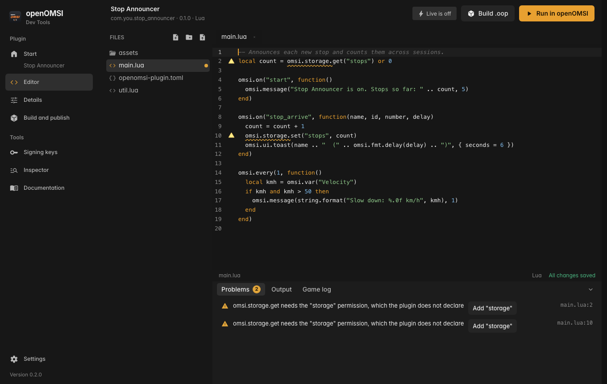
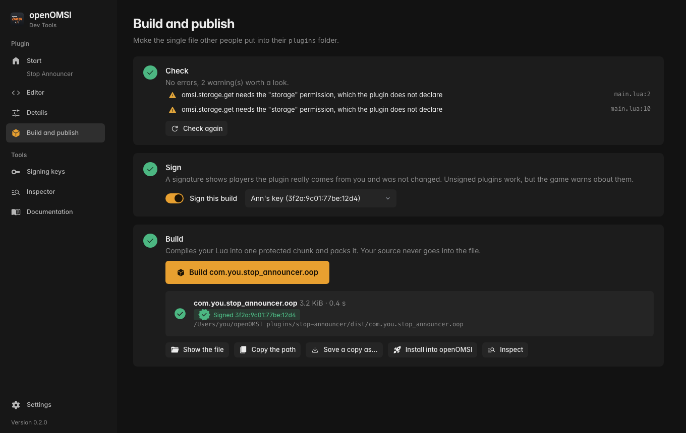
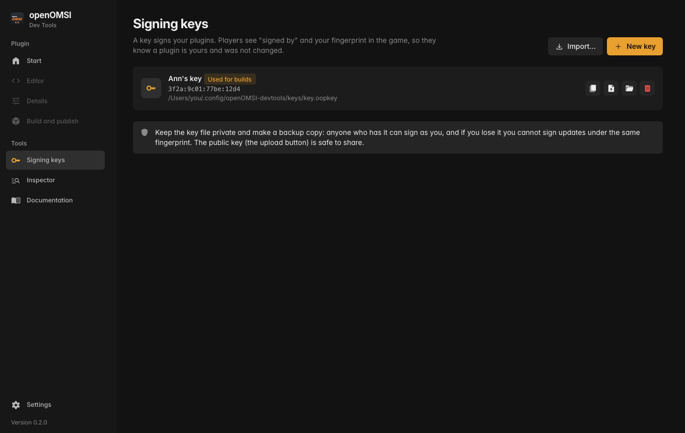
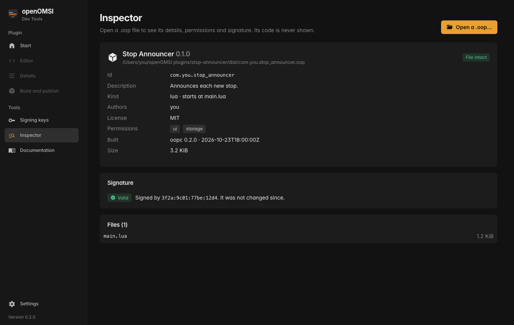

# openOMSI Development Tools

Make **plugins** for [openOMSI](https://github.com/openOMSI-org/openOMSI), the open-source
recreation of the bus simulator OMSI 2. Write a script in the built-in editor, run it in the game
with one button, and build a single signed `.oop` file to share.



- **A real editor.** Lua, Rust, TOML and JSON highlighting, completion and hover help for every
  function and event of the plugin API, mistakes underlined as you type, a problems panel, a
  build output panel and the game's own log.
- **One button to try it.** *Run in openOMSI* copies the plugin into the game and starts it. With
  **Live** on, every save reaches the running game, which loads the plugin again within a second.
- **Plain forms, not config files.** Details, permissions (with a *Match my code* button),
  signing keys, an inspector for `.oop` files. Every path has a Browse button, and the app finds
  openOMSI and `cargo` by itself.
- **One file for every system.** The `.oop` works on Windows, macOS and Linux, never holds your
  source, and can carry your signature.
- **Updates itself.** A new version is offered (or installed by itself, as you choose) after its
  download is checked against its SHA-256.
- **`oopc`**, the same compiler as a command-line tool, and **`openomsi-plugin-sdk`**, a typed
  Rust SDK for plugins that compile to WebAssembly.

## Download

Every download is a `.zip`. Get the one for your system from the
[releases page](https://github.com/openOMSI-org/openOMSI-Development-Tools/releases):

| System | App | Command line |
| --- | --- | --- |
| Windows | `openOMSI-Dev-Tools-<version>-windows-x64.zip` (`windows-arm64`) | `oopc-<version>-windows-x64.zip` |
| macOS | `openOMSI-Dev-Tools-<version>-macos-arm64.zip` (Apple silicon) or `macos-x64` (Intel) | `oopc-<version>-macos-arm64.zip` |
| Linux | `openOMSI-Dev-Tools-<version>-linux-x64.zip` (`linux-arm64`) | `oopc-<version>-linux-x64.zip` |

`SHA256SUMS` on the release lists every checksum. The app needs the WebView2 runtime on Windows
(part of Windows 10 and 11) and `libwebkit2gtk-4.1` on Linux. Rust plugins also need the Rust
toolchain; Settings installs the one extra target they need.

## Quick start

1. Open the app, press **New plugin**, name it, press **Create plugin**.
2. Press **Run in openOMSI**. The app asks once where the game is (it looks in the usual places).
3. Start a drive. Edit the script, save, and the running game picks the change up.
4. When it is ready: **Build and publish**, sign it with your key, share the `.oop`.

A first Lua plugin:

```lua
omsi.on("start", function()
  omsi.message("Hello from my plugin!", 5)
end)

omsi.every(1, function()
  local kmh = omsi.var("Velocity")
  if kmh and kmh > 50 then
    omsi.message(string.format("Slow down: %.0f km/h", kmh), 1)
  end
end)
```

...or in Rust:

```rust
use openomsi_plugin_sdk as omsi;

omsi::plugin!(|| {
    omsi::on_start(|| {
        let _ = omsi::api::message("Hello from my plugin!", Some(5.0));
    });
});
```

## What is a `.oop`?

A compiled, sandboxed plugin, like a DLL but safe to run. Lua is run through an obfuscating
Lua-to-Lua compiler; Rust compiles to a stripped WebAssembly module. The archive is compressed,
encrypted (XChaCha20-Poly1305) and optionally signed with Ed25519. See the
[format and its honest security note](docs/oop-format.md).

## Documentation

- [Getting started](docs/getting-started.md)
- [The `.oop` format](docs/oop-format.md)
- [Command-line reference (`oopc`)](docs/cli.md)
- [Rust SDK](docs/sdk.md)
- [Publishing and signing](docs/publishing.md)

The same pages, with a searchable API reference, are inside the app (**Documentation**) and
published at <https://openomsi-org.github.io/openOMSI-Development-Tools/>.

## The app

| Details and permissions | Build and publish |
| --- | --- |
|  |  |

| Signing keys | Inspector |
| --- | --- |
|  |  |

## Building from source

The app is a [Tauri 2](https://tauri.app) program (the organisation's fork, the one the openOMSI
launcher uses) with a page written in plain JavaScript and Preact in `apps/devtools/ui`; the editor
is CodeMirror 6, bundled by `apps/devtools/editor/build.sh` (Node.js, only when the editor changes).

```sh
cargo build --release -p openomsi-devtools   # the app (Linux: libwebkit2gtk-4.1-dev)
cargo build --release -p oopc                # the command-line compiler
cargo test                                   # tests of the compiler, the format and the SDK
cargo test -p openomsi-devtools              # tests of the app's own code
python3 tools/package.py                     # the .zip packages for this computer, in dist/
cargo xtask gen-sdk <api.json>               # regenerate the SDK's typed API from a manifest
cargo xtask gen-docs                         # build the documentation site
```

The app checks itself end to end without showing a window:
`OPENOMSI_DEVTOOLS_SELFTEST=<empty folder> target/release/openomsi-devtools` makes, builds, signs,
installs and inspects a plugin and draws every page, prints a report and exits.

## License

MIT, see [LICENSE](LICENSE).
